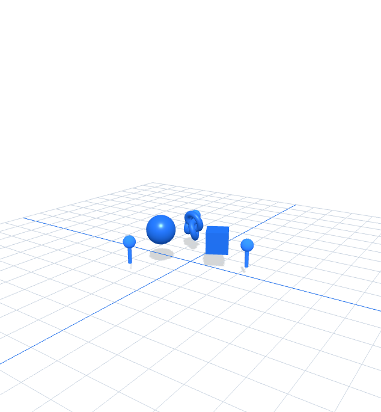

<div align="center">

# AI Vibe Coding for Augmented Reality (AR) Applications

[](https://www.tertiarycourses.com.sg/wsq-ai-vibe-coding-for-augmented-reality-ar-applications.html)
[](https://nodejs.org/)
[](https://threejs.org/)
[](https://www.w3.org/TR/webxr/)
[](#quality-checks)

**Build spatial experiences from natural-language intent, inspect the generated contract, and prove the runtime.**

[Course page](https://www.tertiarycourses.com.sg/wsq-ai-vibe-coding-for-augmented-reality-ar-applications.html) · [Report an issue](https://github.com/tertiarycourses/TGS-2022017519-AI-Vibe-Coding-for-Augmented-Reality-AR-Applications/issues)

</div>

## Screenshot



## About

This learner repository supports **TGS-2022017519**, a two-day WSQ course on AI-assisted AR/VR prototyping. It combines a localhost WebXR studio, eight connected labs, a detailed Learner Guide, and visual v9.0 course slides.

The coding assistant accelerates implementation, but the learner remains responsible for the scene contract, code review, runtime evidence, safety boundaries, and final acceptance.

## What is included

| Component | Purpose |
|---|---|
| Localhost AR/VR Vibe Studio | Turn a natural-language request into a versioned scene contract and desktop/WebXR preview |
| Eight lab folders | Complete procedures, vibe-coding scripts, AR assets, checks, troubleshooting, and cleanup |
| Learner Guide | Detailed technical reference and step-by-step lab instructions |
| Course deck | Highly visual mechanisms, editable charts, runtime contracts, and review evidence |

## Runtime architecture

```text
Natural-language brief
        │
        ▼
Prompt parser ──► ar-vr-vibe-scene/v1 JSON contract
        │                         │
        │                         ├──► validation checks
        ▼                         └──► export / import
Three.js scene engine
        │
        ├──► desktop orbit preview
        ├──► immersive AR + hit-test, when supported
        └──► immersive VR + controller ray, when supported
```

## Labs

1. [Scene Brief and Prompt Contract](labs/lab-01-scene-brief-and-prompt-contract/README.md)
2. [Storyboard and Spatial UI](labs/lab-02-storyboard-and-spatial-ui/README.md)
3. [WebXR Capability and Equipment Gate](labs/lab-03-webxr-capability-and-equipment-gate/README.md)
4. [Scene Graph, Lighting and Animation](labs/lab-04-scene-graph-lighting-and-animation/README.md)
5. [Plane Detection, Hit Test and Anchors](labs/lab-05-plane-detection-hit-test-and-anchors/README.md)
6. [Raycast, Touch and Spatial Feedback](labs/lab-06-raycast-touch-and-spatial-feedback/README.md)
7. [Immersive VR, Controllers and Comfort](labs/lab-07-immersive-vr-controllers-and-comfort/README.md)
8. [Runtime Review, Optimisation and Handover](labs/lab-08-runtime-review-optimisation-and-handover/README.md)

Each lab contains its own `vibe-script.md`, `scene.json`, automated `verify.mjs`, launch script, and asset bundle.

## Getting started

Prerequisites: a current Node.js LTS release and a modern Chromium-based browser. Immersive AR/VR requires a compatible device and browser; the desktop preview is the supported fallback.

```bash
cd webapp
npm install --legacy-peer-deps
npm test
npm run dev
```

Open <http://127.0.0.1:4173/>. To run one lab verifier:

```bash
node ../labs/lab-01-scene-brief-and-prompt-contract/verify.mjs
```

## Project structure

```text
.
├── courseware/             # v9.0 learner artifacts and visual assets
├── labs/                   # eight self-contained lab folders
├── webapp/                 # Vite + Three.js localhost studio
├── LG-*.md                 # searchable Learner Guide mirror
└── README.md
```

## Quality checks

```bash
cd webapp
npm audit --audit-level=moderate
npm test
npm run build

cd ..
for verifier in labs/*/verify.mjs; do node "$verifier"; done
```

Generated code is a proposal until the contract, diff, tests, runtime state, and learner evidence agree. Do not place credentials, personal data, private client material, assessment answer keys, or environment files in prompts or commits.

## Courseware

- [Trainer slides v9.0](courseware/AI%20Vibe%20Coding%20for%20Augmented%20Reality%20%28AR%29%20Applications-v9.0.pdf)
- [Learner Guide](courseware/LG-AI%20Vibe%20Coding%20for%20Augmented%20Reality%20%28AR%29%20Applications.pdf)
- [Lesson Plan](courseware/LP-AI%20Vibe%20Coding%20for%20Augmented%20Reality%20%28AR%29%20Applications.pdf)

Assessment instruments and trainer answer keys are intentionally excluded from this public repository.

## Developed by

Tertiary Infotech Academy Pte Ltd · UEN 201200696W  
<https://www.tertiarycourses.com.sg/>

## Acknowledgements

Built with [Three.js](https://threejs.org/), [Vite](https://vite.dev/), and the [W3C WebXR Device API](https://www.w3.org/TR/webxr/). Device capability, permissions, secure context, physical safety, comfort, and accessibility remain part of the runtime contract.
